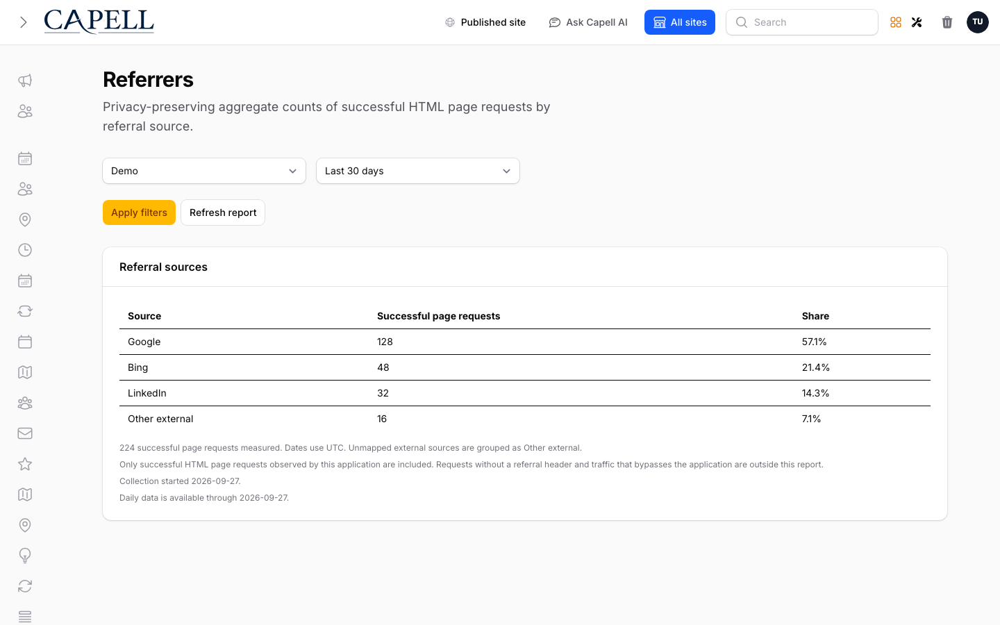

# Referers

<!-- prettier-ignore-start -->

Arrivals from search and social sites are counted by name, with a report in the admin and a card on your dashboard. Google, Facebook and six other well-known sites are named, and every other website is grouped as Other external. A developer must add any other site you want named.

Referers stores only counts, one for each site, each day and each label, plus a running total for each site and label. No IP address, cookie, page address or individual visit is kept. Visits from your own site or with no referring site are ignored, and percentages are shares of the arrivals counted.

Each count is a page Capell builds for an arrival, so a reload can count again and one person can be counted more than once. Crawlers, link-preview fetchers, requests with no browser identity and browser prefetch requests are not counted, nor are pages served from a saved copy such as HTML Cache or a CDN. Daily counts are deleted after 400 days. A source's all-time total is kept while it still has a daily count in that period and is deleted with its last one. That clean-up needs background jobs running.

The admin report offers preset periods up to all time, or a custom range, for each site you can see.

- **Price and availability:** Check current availability and price on the [Capell Marketplace listing](https://capell.app/marketplace/extensions/referer).
- **Licence:** Check the licence terms on the [Capell Marketplace listing](https://capell.app/marketplace/extensions/referer).
- **Requires:** `PHP ^8.4`, `capell-app/admin ^1.0.78`, `capell-app/core ^1.0.78`, `capell-app/frontend ^1.0.71`, `lorisleiva/laravel-actions ^2.8`, `spatie/laravel-data ^4.5`, `spatie/laravel-package-tools ^1.14.1`, `spatie/laravel-referer ^1.9`.
- **Install:** `composer require capell-app/referer:@beta`.

## Quick Start

1. Install the package: `composer require capell-app/referer:@beta`.
2. For Site owners and analysts: Permission to view Referrers and an authorised site. Genuine successful referral-bearing HTML requests are needed for populated counters.
3. Open `/admin/referer`. Select the site and reporting window and apply the filters. Visit a public HTML page through a genuine referring link, then refresh the report.
4. Check the result: Measured referral sources appear for the selected window; empty results mean no eligible requests were measured. Next: Compare sources over another window and inspect the public tracking prerequisites if the expected request is absent.

## For Developers

Typed Actions, bounded validation, atomic upserts, and focused tests keep the privacy contract explicit at each boundary.

## Configure

- **Configuration files:** `config/capell-referer.php`.
- **Commands:** `php artisan capell:referer:demo`, `php artisan capell:referer:prune`, `php artisan capell:referer:screenshot-fixture`.

## Limits And Pitfalls

- Install the required Capell packages at the versions in `composer.json`: `capell-app/admin ^1.0.78`, `capell-app/core ^1.0.78`, `capell-app/frontend ^1.0.71`.
- Run migrations before opening package resources or public routes.
- Keep the host Laravel scheduler running so package-registered schedules can execute: `capell:referer:prune (daily; package registered)`.
- Keep public Blade and cached HTML free of authoring markers, model IDs, permissions, signed editor URLs, and lazy database queries.
- Custom write integrations must preserve invalidation for `referer` cache tags.

## Screens And Workflow

- Site-scoped referral source report (admin).

## Install Impact

- Required packages: `capell-app/admin`, `capell-app/core`, `capell-app/frontend`.
- Admin navigation: declares `admin-page: RefererAdminPageContribution`; each Filament page or resource controls its own navigation visibility.
- Admin/editor extensions: `dashboard-widget: RefererDashboardFilamentWidgetsContribution`.
- Permissions: `View:RefererPage`; Shield-generated page permissions for `Capell\Referer\Filament\Pages\RefererPage` (names and grants depend on host Shield configuration).
- Public routes: none declared.
- Database changes: package migrations are declared.
- Config: `config/capell-referer.php`.
- Settings: no package settings declared.
- Queues or schedules: scheduled commands `capell:referer:prune (daily; package registered)`.
- Cache tags: `referer`.
- Commands: `capell:referer:demo`, `capell:referer:prune`, `capell:referer:screenshot-fixture`.

## Troubleshooting

| Symptom | Likely cause | Check | Fix |
| --- | --- | --- | --- |
| Package surface is missing after install | Provider or manifest is not loaded | Confirm `capell.json`, package `composer.json`, and provider registration | Reinstall the package, refresh Composer autoload, and clear host caches |
| Admin screen or command fails on missing table | Package migrations have not run | Check the tables listed in `Data Model` | Run host migrations and rerun the focused package test |
| Background work does not run | Queue worker or declared schedule is not active | Check the jobs and scheduled commands listed in `Technical Shape` | Start the queue worker or host scheduler, then run the focused command or package test |
| Public output leaks unexpected state | Render data, cache variation, or authoring boundary has regressed | Check public Blade, cache tags, and public-output safety tests | Move data loading out of Blade and rerun the package public-output tests |

## Upgrading

No manual steps between minor versions.

## Next Steps

- [Package docs](docs/README.md)
- [Overview](docs/overview.md)
- [Worked extension examples](docs/extension-contracts.md)
- [Admin guide](docs/admin-guide.md)
- Configuration files: [`config/capell-referer.php`](config/capell-referer.php).
- [Troubleshooting](#troubleshooting)
- [Developer reference](docs/reference.md)
- [Marketplace assets](docs/assets/marketplace/)
- [Capell content language plan](../../docs/CONTENT_LANGUAGE_PLAN.md)
- [Capell documentation design system](../../docs/DESIGN_SYSTEM.md)
- [Capell and package ERD notes](../../docs/erd/capell-and-package-erds.md)

<!-- prettier-ignore-end -->
