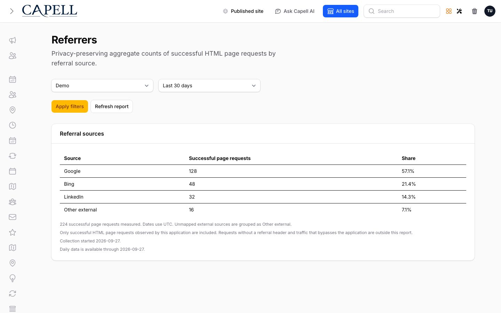

# Referers

<!-- prettier-ignore-start -->

## What It Does

Referers adds privacy-preserving aggregate referral reporting to Capell. It keeps daily and lifetime counters for finite source keys without storing raw URLs or request identifiers.

- **Price and availability:** Check current availability and price on the [Capell Marketplace listing](https://capell.app/extensions/referer).
- **Licence:** Check the licence terms on the [Capell Marketplace listing](https://capell.app/extensions/referer).
- **Requires:** `PHP ^8.4`, `capell-app/admin ^1.0.66`, `capell-app/core ^1.0.75`, `capell-app/frontend ^1.0.71`, `lorisleiva/laravel-actions ^2.8`, `spatie/laravel-data ^4.5`, `spatie/laravel-package-tools ^1.14.1`, `spatie/laravel-referer ^1.9`.
- **Install:** `composer require capell-app/referer`.

Administrators review site-scoped referral counts in a cached Referrers report and a small dashboard widget, while origin frontend renders record successful HTML responses best-effort.

## Who It Is For

**For developers:** Typed Actions, bounded validation, atomic upserts, and focused tests keep the privacy contract explicit at each boundary.

**For teams:** Site teams can see which configured external sources contribute successful page requests without receiving a browsing-event log.

## Quick Start

1. Install the package: `composer require capell-app/referer`.
2. For Site owners and analysts: Permission to view Referrers and an authorised site. Genuine successful referral-bearing HTML requests are needed for populated counters.
3. Open `/admin/referer`. Select the site and reporting window and apply the filters. Visit a public HTML page through a genuine referring link, then refresh the report.
4. Check the result: Measured referral sources appear for the selected window; empty results mean no eligible requests were measured. Next: Compare sources over another window and inspect the public tracking prerequisites if the expected request is absent.

## Configure

- **Configuration files:** `config/capell-referer.php`.
- **Commands:** `php artisan capell:referer:prune`, `php artisan capell:referer:screenshot-fixture`.

## Limits And Pitfalls

- Install the required Capell packages at the versions in `composer.json`: `capell-app/admin ^1.0.66`, `capell-app/core ^1.0.75`, `capell-app/frontend ^1.0.71`.
- Run migrations before opening package resources or public routes.
- Keep the host Laravel scheduler running so package-registered schedules can execute: `capell:referer:prune (daily; package registered)`.
- Keep public Blade and cached HTML free of authoring markers, model IDs, permissions, signed editor URLs, and lazy database queries.
- Custom write integrations must preserve invalidation for `referer` cache tags.

## Screens And Workflow

- Site-scoped referral source report (admin).

## Install Impact

- Required packages: `capell-app/admin`, `capell-app/core`, `capell-app/frontend`.
- Admin navigation: declares `admin-page: RefererAdminPageContribution`; each Filament page or resource controls its own navigation visibility.
- Admin/editor extensions: `dashboard-widget: RefererDashboardFilamentWidgetsContribution`.
- Permissions: `View:RefererPage`; Shield-generated page permissions for `Capell\Referer\Filament\Pages\RefererPage` (names and grants depend on host Shield configuration).
- Public routes: none declared.
- Database changes: package migrations are declared.
- Config: `config/capell-referer.php`.
- Settings: no package settings declared.
- Queues or schedules: scheduled commands `capell:referer:prune (daily; package registered)`.
- Cache tags: `referer`.
- Commands: `capell:referer:prune`, `capell:referer:screenshot-fixture`.

## Troubleshooting

| Symptom | Likely cause | Check | Fix |
| --- | --- | --- | --- |
| Package surface is missing after install | Provider or manifest is not loaded | Confirm `capell.json`, package `composer.json`, and provider registration | Reinstall the package, refresh Composer autoload, and clear host caches |
| Admin screen or command fails on missing table | Package migrations have not run | Check the tables listed in `Data Model` | Run host migrations and rerun the focused package test |
| Background work does not run | Queue worker or declared schedule is not active | Check the jobs and scheduled commands listed in `Technical Shape` | Start the queue worker or host scheduler, then run the focused command or package test |
| Public output leaks unexpected state | Render data, cache variation, or authoring boundary has regressed | Check public Blade, cache tags, and public-output safety tests | Move data loading out of Blade and rerun the package public-output tests |

## Upgrading

No manual steps between minor versions.

## Next Steps

- [Package docs](docs/README.md)
- [Overview](docs/overview.md)
- [Worked extension examples](docs/extension-contracts.md)
- [Admin guide](docs/admin-guide.md)
- Configuration files: [`config/capell-referer.php`](config/capell-referer.php).
- [Troubleshooting](#troubleshooting)
- [Developer reference](docs/reference.md)
- [Marketplace assets](docs/assets/marketplace/)
- [Capell content language plan](../../docs/CONTENT_LANGUAGE_PLAN.md)
- [Capell documentation design system](../../docs/DESIGN_SYSTEM.md)
- [Capell and package ERD notes](../../docs/erd/capell-and-package-erds.md)

<!-- prettier-ignore-end -->
